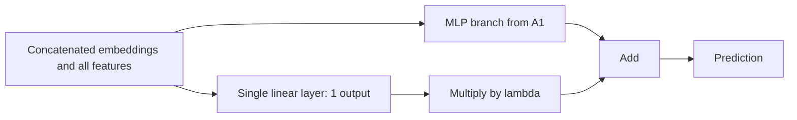
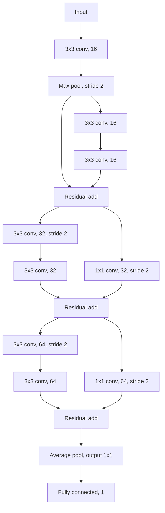

# SC4001 Neural Networks and Deep Learning - Programming Assignment

> Markdown reference for [`assignment.pdf`](./assignment.pdf) (7 pages).
>
> This file preserves the assignment's requirements, parameter grids, metrics, submission rules, dataset descriptions, and figure structure in a format suitable for future AI chats. Diagrams have been converted to Mermaid and text. If this reference and the source PDF ever appear to disagree, treat the PDF as authoritative.

## Document metadata

- Module: SC4001 Neural Networks and Deep Learning
- Assessment: Programming Assignment
- Deadline: October 12, 2026
- Work mode: Individual
- Total marks: 100
  - Part A: 45 marks
  - Part B: 45 marks
  - Presentation: 10 marks

## General and submission requirements (source page 1)

- This assignment is to be done individually. You may discuss the questions with others, but your submission must be your own unique work.
- Complete both Part A and Part B.
- Submit Part A and Part B separately through NTULearn before the deadline:
  - `PartA_report_YourName.pdf`
  - `PartA_codes_YourName.zip`
  - `PartB_report_YourName.pdf`
  - `PartB_codes_YourName.zip`
- Use a 3-way data split for parameter estimation and model evaluation.
- Use the Adam optimizer for training throughout the assignment.
- Use early stopping throughout the assignment:
  - Maximum epochs: 20
  - Patience: 4 epochs
  - Minimum improvement: `1e-4`
- Code requirements:
  - Python source files (`.py`) or Python notebooks (`.ipynb`)
  - Tidied and properly labelled
  - Ready to run from beginning to end
  - Include a README documenting environments, dependencies, seeds, and commands for running the code
- Assessment is based on the submitted reports. Code is used only for verification.
- Each report must:
  - Be concise
  - Answer only the questions asked
  - Be **less than 6 pages**
- Ten marks are reserved for presentation of the solutions.
- Late submissions are penalized by **5% for each day**, for up to three days.
- A **Generative AI Declaration** must appear at the beginning of the report.
  - If any GenAI tool, such as ChatGPT, GitHub Copilot, Claude, or Gemini, was used at any stage for code generation, debugging, writing, or interpretation, state:
    - Which tool or tools were used
    - The purpose for which each was used
    - How the output was verified
  - Undisclosed GenAI use will be treated as an academic integrity violation.
- Post general assignment questions on the NTULearn Discussion Board.
- Send questions specific to you to `cx4042@e.ntu.edu.sg`.
- Teaching assistants:
  - Ms. Yige Yan
  - Mr. Ajith Santhisenan
  - Mr. Deepank Girish
  - Ms. Tiara Natasha

---

# Part A: Regression Problem

## Problem and dataset (source page 2)

Develop deep neural networks to predict Singapore HDB resale prices. A complete end-to-end PyTorch baseline, `baseline.py`, is provided.

The HDB flat-price data is publicly available from data.gov.sg. The [original dataset](https://beta.data.gov.sg/datasets/189/resources/d_8b84c4ee58e3cfc0ece0d773c8ca6abc/view) is combined with other datasets to produce the more informative features in `hdb_price_prediction.csv`.

Open `housing_baseline_data.zip` and follow its README instructions to extract the source and data files.

### Required temporal split

| Partition | Years | Purpose |
|---|---:|---|
| Training | 2017-2020 | Parameter estimation |
| Validation | 2021 | Validation and model selection |
| Test | 2022 | Final testing |

### Features

| Feature | Type | Explanation |
|---|---|---|
| `month` | Categorical (Int) | Month in which the resale transaction was performed. |
| `year` | Categorical (Int) | Year in which the resale transaction was performed. Used for the data split, not as a model input. |
| `town` | Categorical (Str) | An area zoned for public housing. Generally, a town consists of a self-sufficient group of HDB flats with amenities and a town centre. Each town has a population of around 50,000-250,000. See [New towns of Singapore](https://en.wikipedia.org/wiki/New_towns_of_Singapore). |
| `full_address` | Categorical (Str) | Address of the flat. Not used for modelling because metrics derived from it are used instead: `dist_to_nearest_stn` and `dist_to_dhoby`. |
| `nearest_stn` | Categorical (Str) | Closest MRT station to the flat. Not used for modelling because metrics derived from it are used instead: `degree_centrality` and `eigenvector_centrality`. |
| `dist_to_nearest_stn` | Numeric | Distance from the flat to the nearest MRT station, in kilometres. Flats near stations tend to fetch higher prices. |
| `dist_to_dhoby` | Numeric | Distance from the flat to Dhoby Ghaut MRT station, in kilometres. Dhoby Ghaut is chosen because it is centrally located. Flats in the Central region are typically more costly. |
| `degree_centrality` | Numeric | Metric computed for the closest MRT station that represents the degree of the node, meaning the number of edges connected to it. Rationale: flats near interchange stations with more than one MRT line offer more transport options and may have higher value. Stations in central areas also tend to have more than one MRT line. |
| `eigenvector_centrality` | Numeric | A more global metric than `degree_centrality` because it captures neighbourhood information. A node with high eigenvector centrality is likely to be adjacent to nodes that also have high values. |
| `flat_model_type` | Categorical (Str) | Type of flat. See [this floor-plan/type reference](https://www.teoalida.com/singapore/hdbfloorplans/) for details. Students are not expected to understand every flat type. |
| `remaining_lease_years` | Numeric | HDB flats are originally sold with a 99-year lease. With other variables held constant, flats with a longer remaining lease generally fetch a higher value. The source value in years and months was converted to a scalar by converting it to months and dividing by 12. |
| `floor_area_sqm` | Numeric | Size of the flat in square metres. Bigger flats generally fetch higher prices. |
| `storey_range` | Categorical (Str) | Floor range of the flat. For the same HDB block, flats on higher floors typically fetch higher prices. |
| `resale_price` | Numeric | Flat price in Singapore dollars. **Prediction target.** |

The ten original model inputs referenced in A4 are the four categorical inputs (`month`, `town`, `flat_model_type`, `storey_range`) and six continuous inputs (`dist_to_nearest_stn`, `dist_to_dhoby`, `degree_centrality`, `eigenvector_centrality`, `remaining_lease_years`, `floor_area_sqm`).

## Question A1 - Baseline and hyperparameter optimisation (13 marks; source page 3)

1. Draw a block diagram of the baseline model.
2. Report the number of trainable parameters in the baseline.
3. Perform grid-search hyperparameter optimisation using the Ray library.
4. Search the Cartesian product of:
   - Hidden-layer width: `{16, 32, 64, 128, 256}`
   - A single shared embedding dimension for all four categorical features: `{2, 4, 8, 12, 16}`
5. Select the configuration with the lowest **best validation RMSE**.
6. Report the optimal parameter values.
7. For the selected configuration, plot training and validation RMSE curves on the same axes.
8. Retrain the selected model on the combined training and validation sets.
9. Evaluate the retrained model on the test set.
10. Plot training and testing RMSE curves on the same axes.
11. Report final test RMSE and R².
12. Use evidence from the hyperparameter-search results and learning curves to discuss and justify the selected configuration, including whether the model underfits or overfits.

## Question A2 - Ablation experiments (13 marks; source page 3)

Use the architecture selected in A1. Train the A1 baseline and both ablations on the combined training and validation partitions using **five distinct seeds of your choice**.

Keep the following identical for all runs:

- Preprocessing
- Hyperparameters selected in A1
- Number of epochs selected in A1

Evaluate each trained model once on the test set. Across the five seeds, report the mean and standard deviation of test RMSE and R².

### Ablation A2(a): remove categorical embeddings

- Remove all four categorical embedding tables.
- Use only the six continuous features as input.
- Adjust the first linear layer's input dimension accordingly.
- Keep the hidden-layer width unchanged.

### Ablation A2(b): replace the activation

- Retain both categorical and continuous inputs.
- Replace the hidden ReLU activation with a Sigmoid activation.

Discuss and explain conclusions from both ablations, supported by evidence from the results and plots of RMSE and R².

## Question A3 - Wide-and-deep architecture (13 marks; source pages 3-4)

Evaluate the wide-and-deep architecture in Figure A against the A1 baseline.

- Both branches receive the same concatenated embeddings and all features.
- The linear branch consists of a single linear layer with one output.
- The MLP branch uses the architecture selected in A1.
- The final prediction is:

$$
\text{output} = \text{MLP output} + \lambda \times \text{linear output}
$$

### Figure A - structural transcription



Required work:

1. Find the optimal value of $\lambda$ from `{0, 0.25, 0.5, 1, 2}` while keeping the selected A1 hyperparameters fixed.
2. Evaluate the selected wide-and-deep configuration using five different seeds.
3. Report the mean and **sample standard deviation** of test RMSE and R², with relevant plots.
4. Compare the selected wide-and-deep model with the A1 baseline results.
5. Explain the mechanism by which the architectural change could affect optimisation or generalisation.
6. Determine whether the evidence is consistent with that mechanism.
7. Discuss at least one limitation or confound in the comparison.

## Question A4 - Feature Ablation explainability (6 marks; source page 4)

Use Captum's `FeatureAblation` method on the test set to explain:

- The final baseline model from A1
- The wide-and-deep model from A3

Use the **same seed** to train both models.

For each model:

1. Compute the `FeatureAblation` attribution of each of the ten original input features for every test sample.
2. For every feature, calculate a global feature-importance score as the mean absolute attribution across all test samples.
3. Present all ten feature-importance scores in Singapore dollars in a labelled bar plot, ordered from highest to lowest.
4. Report the three most important features.
5. Discuss and compare the two models' results.
6. Identify one limitation of the analysis.

---

# Part B: Classification Problem

## Problem, data, and shared architecture rules (source page 5)

Classify chest X-ray images from healthy subjects and pneumonia patients. The dataset is supplied as `chestxray_binary_64.npz` and is already divided into training, validation, and test partitions.

### Preprocessing

1. Scale grey-level pixel intensities to `[0, 1]`.
2. Compute the mean and standard deviation on the **training set**.
3. Normalize the images using those training-set statistics.

### Rules shared by B1-B3

- Use the CNN architectures shown in Figure B.
- Apply batch normalization and ReLU after each convolutional layer.
- ReLU is also applied after every residual addition in B3.
- Use SAME padding for every convolutional layer.
- A layer marked `/2` has stride 2; all other layers have stride 1.
- Use bias in fully connected layers.
- Do **not** use bias in convolutional layers.
- Apply dropout with probability `0.5` only in the hidden fully connected layers of the B1 architecture.

## Figure B - architecture transcription (source page 5)

### B1: AlexNet-like architecture

```text
input
  -> 5x5 conv, 16
  -> max pool, /2
  -> 5x5 conv, 32
  -> max pool, /2
  -> 3x3 conv, 64
  -> max pool, /2
  -> average pool, output 4x4
  -> fully connected, 64
  -> fully connected, 32
  -> fully connected, 1
```

Dropout `0.5` applies to the hidden fully connected layers (`fc 64` and `fc 32`).

### B2: VGG-like architecture

```text
input
  -> 3x3 conv, 8
  -> 3x3 conv, 8
  -> max pool, /2
  -> 3x3 conv, 16
  -> 3x3 conv, 16
  -> max pool, /2
  -> 3x3 conv, 32
  -> 3x3 conv, 32
  -> max pool, /2
  -> average pool, output 1x1
  -> fully connected, 1
```

### B3: compact ResNet-like architecture



The first residual block uses an identity skip from the output of the max-pooling layer. The later two blocks use stride-2 `1x1` convolutional projection shortcuts to match spatial size and channel count.

## Question B1 - AlexNet-like model and learning rate (13 marks; source page 6)

1. Implement and train the B1 AlexNet-like architecture.
2. Use batch size `128`.
3. Train separately with learning rates `{1e-5, 1e-4, 1e-3, 1e-2, 1e-1}`.
4. Produce two separate figures across the five learning rates:
   - Validation loss against epoch
   - Validation accuracy against epoch
5. Present a table containing:
   - Learning rate
   - Best epoch
   - Validation loss
   - Validation classification error (`1 - accuracy`)
   - Sensitivity
   - Specificity
6. Select the optimal learning rate using the lowest validation classification error.
7. Support the selection with the reported results.
8. Explain what the curves show about convergence.
9. Discuss why sensitivity and specificity are also needed to interpret performance.
10. Evaluate the final model **once** on the test set and report:
    - Accuracy
    - Sensitivity
    - Specificity

## Question B2 - VGG-like model and batch size (13 marks; source page 6)

1. Implement the B2 VGG-like architecture.
2. Use the best learning rate found in B1.
3. Train separately with batch sizes `{16, 32, 64, 128, 256}`.
4. Produce two separate figures across the five batch sizes:
   - Validation loss against epoch
   - Validation accuracy against epoch
5. Present a table containing:
   - Batch size
   - Best epoch
   - Validation loss
   - Validation classification error (`1 - accuracy`)
   - Sensitivity
   - Specificity
6. Select the optimal batch size using the lowest validation classification error.
7. Explain the selection using the reported results.
8. Evaluate the final model **once** on the test set and report:
   - Accuracy
   - Sensitivity
   - Specificity

## Question B3 - Compact ResNet-like model and architecture comparison (13 marks; source page 6)

1. Implement the B3 compact ResNet-like architecture.
2. Train it using:
   - The best learning rate from B1
   - The best batch size from B2
3. Report accuracy, sensitivity, and specificity.
4. Compare the B1-B3 architectures in a table containing:
   - Accuracy
   - Sensitivity
   - Specificity
   - Classification error
   - Number of learnable parameters
   - Floating-point operations (FLOPs)
5. State the advantages and disadvantages of the different architectures.

## Question B4 - Grad-CAM explainability (6 marks; source pages 6-7)

Pneumonia chest X-rays show abnormal white and cloudy patches. Investigate whether explainable-AI methods identify these patches using Grad-CAM, available through Captum for PyTorch.

1. Randomly select **five** representative X-rays from pneumonia patients.
2. Implement Grad-CAM for each architecture developed in B1-B3.
3. Overlay the Grad-CAM heatmaps on the X-ray images.
4. Compare the resulting visual explanations.

## Compact requirement matrix

| Question | Search/comparison | Seeds/evaluation | Required metrics/outputs |
|---|---|---|---|
| A1 | 5 widths x 5 shared embedding sizes using Ray | Select on 2021 validation; retrain on train+validation; test on 2022 | Train/validation RMSE curves; train/test RMSE curves; final RMSE and R²; parameter count; under/overfitting discussion |
| A2 | Baseline vs continuous-only vs Sigmoid | 5 distinct seeds per model; one test evaluation per trained model | Mean and SD of test RMSE and R²; plots and conclusions |
| A3 | $\lambda \in \{0, 0.25, 0.5, 1, 2\}$ | Selected model on 5 seeds | Mean and sample SD of test RMSE and R²; plots; baseline comparison; mechanism and limitation/confound |
| A4 | Baseline vs wide-and-deep | Same training seed for both | Per-sample FeatureAblation for 10 inputs; global mean absolute attribution in SGD; ordered bar plots; top 3 features; limitation |
| B1 | Learning rates `{1e-5, 1e-4, 1e-3, 1e-2, 1e-1}`; batch size 128 | Select by validation error; test final model once | Validation loss/accuracy curves; selection table; test accuracy, sensitivity, specificity |
| B2 | Batch sizes `{16, 32, 64, 128, 256}`; best B1 LR | Select by validation error; test final model once | Validation loss/accuracy curves; selection table; test accuracy, sensitivity, specificity |
| B3 | Compare B1, B2, B3 | Use best B1 LR and best B2 batch size | Accuracy, sensitivity, specificity, error, parameter count, FLOPs, pros/cons |
| B4 | Grad-CAM across B1-B3 | 5 randomly selected representative pneumonia X-rays | Overlay heatmaps and compare |

