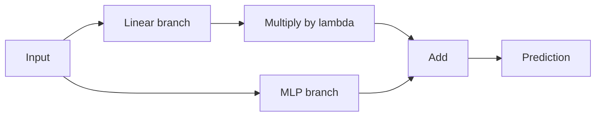
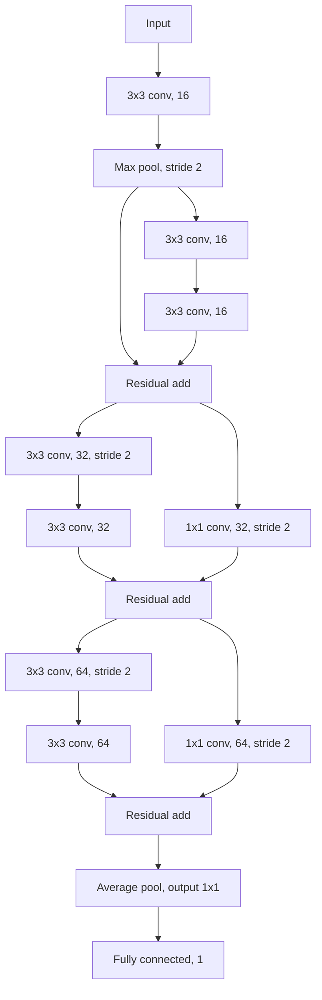

# SC4001 Programming Assignment Slides

> Markdown reference for [`assignment_slides.pdf`](./assignment_slides.pdf) (6 slides).
>
> These slides are a short overview of the programming assignment, not the full specification. They contain apparent shorthand and typographical discrepancies. This file preserves what the slides show while recording the corresponding authoritative values from [`assignment.pdf`](./assignment.pdf). When implementing or reporting the assignment, follow `assignment.pdf` / [`assignment.md`](./assignment.md).

## Important discrepancies from the full assignment

| Topic | Slides show | Full assignment says | Use |
|---|---|---|---|
| A3 lambda grid | `{0, 0.25, 0.5, 1.2}` | `{0, 0.25, 0.5, 1, 2}` | `{0, 0.25, 0.5, 1, 2}` |
| B2 batch-size grid | `{16, 32, 64, 128, 258}` | `{16, 32, 64, 128, 256}` | `{16, 32, 64, 128, 256}` |
| Report length | "6 pages each" | "less than 6 pages each" | Less than 6 pages each |
| Late penalty | "5 marks for each day" | `5%` for each day | 5% per day, up to 3 days |
| Source-code wording | `.py` and `.ipynb` | `.py` or `.ipynb` | Either format is allowed; ensure the code runs end-to-end |

---

## Slide 1 - Title

**SC4001: Neural Networks and Deep Learning**

Programming Assignment

---

## Slide 2 - Part A: Regression with DNN

Predict Singapore housing price from categorical and continuous inputs.

### Question A1 - baseline model

- Each categorical feature is first indexed and then converted to an embedding of dimension 8 using an `nn.Embedding` layer containing learnable weights.
- Draw a block diagram of the baseline network.
- Compute the number of learnable parameters.
- Find the optimal combination of embedding dimension and hidden-layer width using `ray[tune]`.

### Question A2 - ablation

- Ablation (i): remove categorical variables.
- Ablation (ii): replace the ReLU layer with a sigmoidal layer.
- Perform experiments with five seeds using `torch.manual_seed(seed)`.
- Report mean and standard deviation.
- Compare the ablations with the baseline.

---

## Slide 3 - Part A continued

### Question A3 - wide-and-deep architecture

The displayed computation is:

$$
\text{output} = \text{MLP output} + \lambda \times \text{linear output}
$$



- The slide displays: "Find the optimal parameter $\lambda \in \{0, 0.25, 0.5, 1.2\}$".
- This appears to combine `1` and `2` typographically. The full assignment's authoritative grid is `{0, 0.25, 0.5, 1, 2}`.
- Evaluate the optimal network over five seeds and compare it with the baseline architecture.

### Question A4 - XAI

- Use Captum's `FeatureAblation` method.
- Find feature-importance scores in Singapore dollars.

---

## Slide 4 - Part B: classification with CNN

The slide contains the three Figure B architectures.

### B1 - AlexNet-like architecture

```text
input
  -> 5x5 conv, 16
  -> max pool, /2
  -> 5x5 conv, 32
  -> max pool, /2
  -> 3x3 conv, 64
  -> max pool, /2
  -> average pool, output 4x4
  -> fully connected, 64
  -> fully connected, 32
  -> fully connected, 1
```

### B2 - VGG-like architecture

```text
input
  -> 3x3 conv, 8
  -> 3x3 conv, 8
  -> max pool, /2
  -> 3x3 conv, 16
  -> 3x3 conv, 16
  -> max pool, /2
  -> 3x3 conv, 32
  -> 3x3 conv, 32
  -> max pool, /2
  -> average pool, output 1x1
  -> fully connected, 1
```

### B3 - ResNet-like architecture



### Shared architecture notes shown on the slide

- B1 is AlexNet-like, B2 is VGG-like, and B3 is ResNet-like.
- Every layer uses ReLU, including after residual addition.
- Every convolutional layer uses BatchNorm and SAME padding.
- Layers marked `/2` use stride 2; all other layers use stride 1.
- Dropout `0.5` is applied only in the hidden fully connected layers of B1.

---

## Slide 5 - Part B questions

### Question B1 - AlexNet-like architecture

- Find the optimal learning rate from `{1e-5, 1e-4, 1e-3, 1e-2, 1e-1}`.
- Plot learning curves, evaluate, and complete the other work detailed in the full assignment.

### Question B2 - VGG-like architecture

- The slide displays batch sizes `{16, 32, 64, 128, 258}`.
- `258` is an apparent typo. The full assignment's authoritative final value is `256`.
- Plot learning curves, evaluate, and complete the other work detailed in the full assignment.

### Question B3 - ResNet-like architecture

- Use the learning rate selected in B1 and the batch size selected in B2.
- Plot learning curves and evaluate the model.
- Compare B1-B3 on performance, number of learnable parameters, FLOPs, and the other criteria detailed in the full assignment.

### Question B4 - XAI

- Use the Grad-CAM method from Captum.
- Overlay Grad-CAM heatmaps on X-ray images.

---

## Slide 6 - Housekeeping rules

The slide summarizes the following:

- Assessment is based on the reports; code is used for checking.
- The slide says "6 pages each," while the full assignment more strictly requires each report to be **less than 6 pages**.
- Required filenames:
  - `PartA_report_YourName.pdf`
  - `PartA_codes_YourName.zip`
  - `PartB_report_YourName.pdf`
  - `PartB_codes_YourName.zip`
- Marks:
  - Part A: 45
  - Part B: 45
  - Presentation: 10
- Follow the instructions closely. Deviations may lead to loss of presentation marks.
- Code must be in `.py` or `.ipynb`, tidied, properly labelled, and ready to run. Include a README.
- Include a Generative AI declaration.
- The slide states a late penalty of "5 marks for each day up to 3 days." The full assignment specifies **5% per day for up to three days**, which should be treated as authoritative.
- The work is individual. No copying, duplication, or plagiarism.
- Post general queries on the NTULearn Discussion Board.
- Send specific questions for help to `cx4042@e.ntu.edu.sg`.
- TAs as written on the slide:
  - Deepank Girish
  - Yan Yige
  - Tiara Natasha
  - Ajith Senthisenan

For the official spelling and ordering of names, the full assignment lists Ms. Yige Yan, Mr. Ajith Santhisenan, Mr. Deepank Girish, and Ms. Tiara Natasha.

