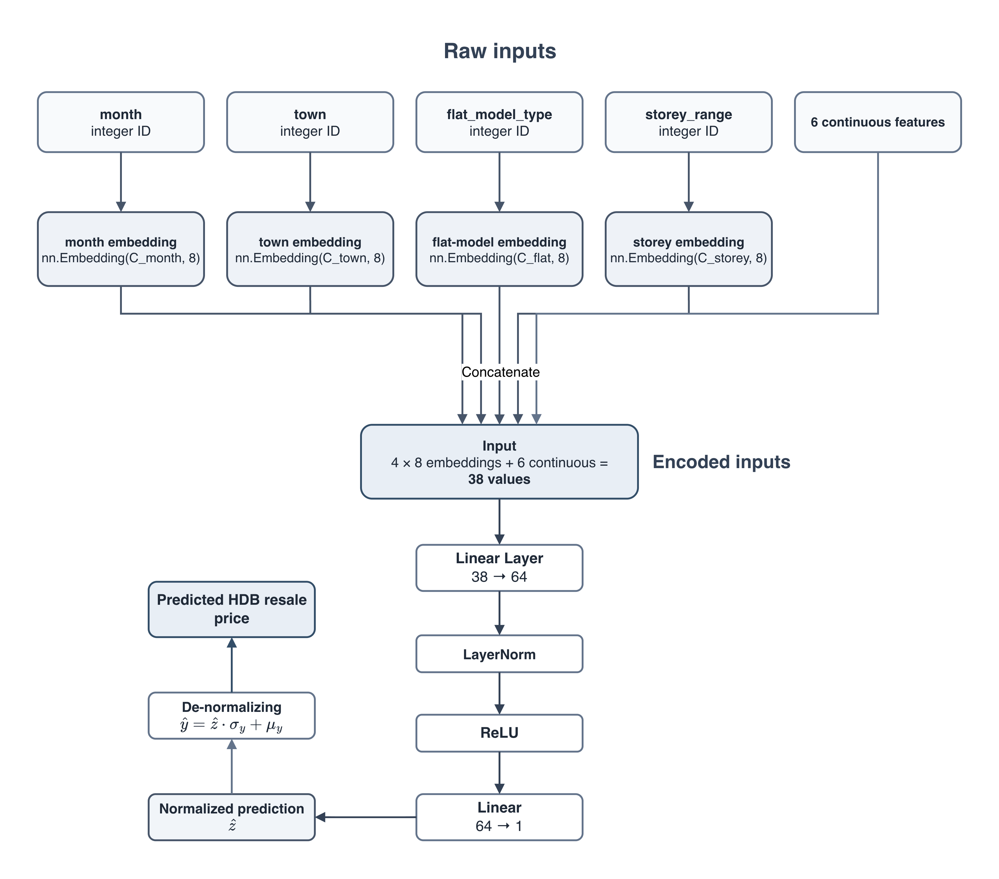
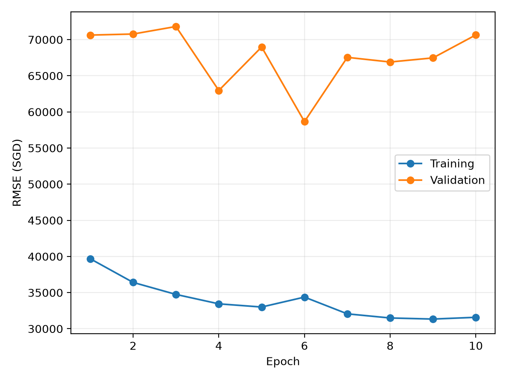
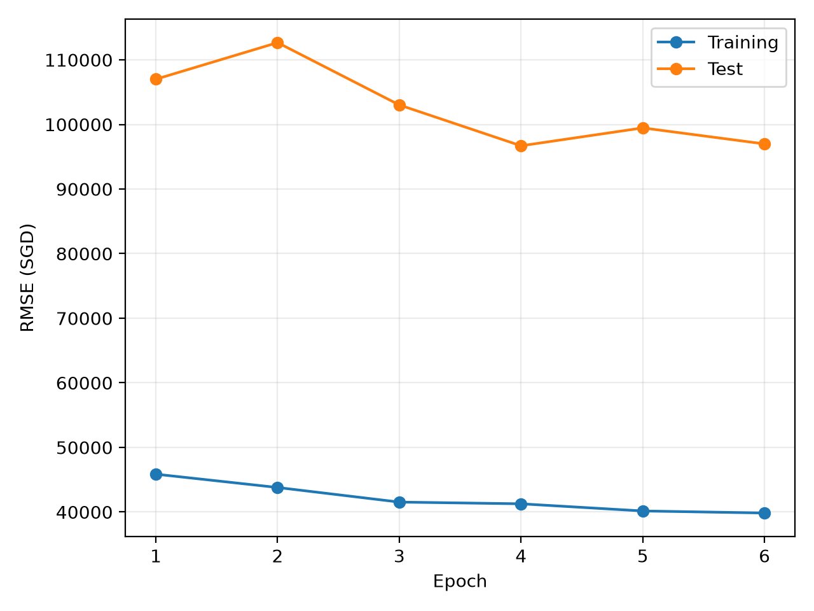
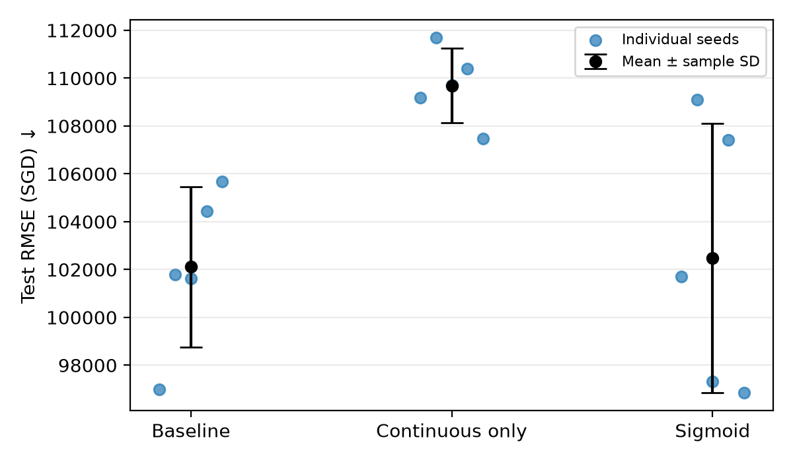
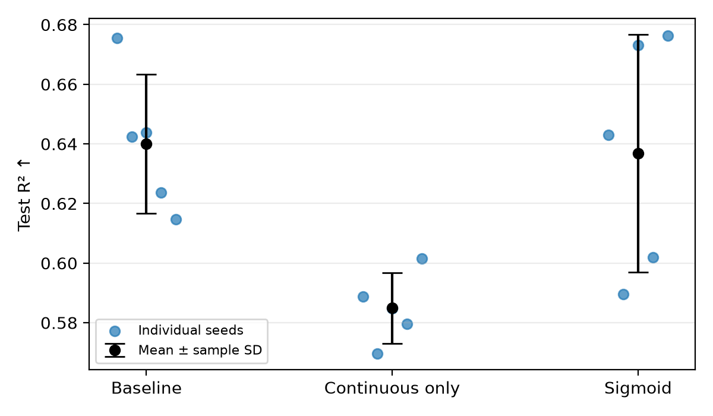

# Generative AI declaration

For A2, ChatGPT (Codex) was used to help plan the experiments, write the notebook,
and draft the report text. The code was checked with a small test run and a full
five-seed run. Model structures, seeded reproducibility, summary calculations,
and the seed-42 baseline's agreement with A1 were verified.

# A1

## Baseline model

The baseline has **3,505 trainable parameters**: 816 embedding, 2,496 first
linear-layer, 128 LayerNorm, and 65 output-layer parameters.

## Hyperparameter optimisation

| Hidden width | Emb. 2 | Emb. 4 | Emb. 8 | Emb. 12 | Emb. 16 |
|---:|---:|---:|---:|---:|---:|
| 16  | 65,190 | 64,673 | 64,185 | 65,347 | 66,107 |
| 32  | 64,021 | 64,763 | 63,221 | 63,752 | 61,598 |
| 64  | 64,970 | 64,376 | 62,081 | 60,785 | 60,505 |
| 128 | 62,393 | 62,755 | 62,612 | 59,732 | 60,961 |
| 256 | 62,909 | **58,657** | 61,123 | 61,691 | 60,592 |

***Table 1.** Grid-search best validation RMSE.*

### Optimal parameter values
* Lowest best validation RMSE is 58,657
* This belongs to the model with **hidden width 256** and **shared embedding dimension 4** *(optimal parameters)*

### Plot of training and validation RMSE curves

Training early-stopped at epoch 10, with the lowest validation RMSE at **epoch 6**.

## Final model

The selected model was reinitialised and trained on train & validation for **6 epochs**.

The final results were **RMSE = 96,984.81** and **$R^2=0.6755$**.

### Discussion on model configuration

* **Hidden width 256 & embedding dimension 4:** selected as optimal parameters through Ray grid-search, yielding the lowest RMSE of 58,657.
* **6 training epochs**: selected through early-stopping &mdash; epoch 6 yielded the lowest RMSE when training 2017-2020 data to validate on 2021 data

**Underfitting/Overfitting:** As seen in the learning curve, the model performs well on training data (low RMSE) yet badly on unseen data (high RMSE for val/test). This strongly suggests **overfitting**.
Additionally, since the data is split based on years, the model may learn correct patterns to analyze 2017-2021 house prices, but those patterns may not realistically apply to the house prices of 2022 &rArr; **Possible reason for overfitting**

# A2

## Ablation experiments

The A1 baseline and both ablations were trained on **2017-2021** using seeds
**42, 43, 44, 45, and 46** and tested on 2022.

All runs used the same preprocessing, same **hidden width 256**,
Adam with **learning rate 0.01**, **batch size 512**, **6 epochs**, and **embedding dimension 4** wherever embeddings were used.

* **A2(a) - Continuous only:** removed all four embedding tables and changed
  the first linear layer from 22 inputs to the six continuous inputs.
* **A2(b) - Sigmoid:** retained all inputs and replaced the hidden ReLU with
  Sigmoid.

## Results

| Model | Test RMSE (SGD) | Test $R^2$ |
|---|---:|---:|
| A1 baseline | **102,109.27 ± 3,350.74** | **0.6400 ± 0.0234** |
| A2(a): Continuous only | 109,688.83 ± 1,557.27 | 0.5849 ± 0.0118 |
| A2(b): Sigmoid | 102,481.73 ± 5,629.96 | 0.6368 ± 0.0400 |

***Table 2.** **Mean** ± **standard deviation** across five seeds. Lower RMSE
and higher $R^2$ indicate better performance.*

The plots show each seed's result and the mean ± sample standard deviation:

### Discussion on ablations

* **Removing categorical inputs:**
  * Mean RMSE increased by **7,579.56**
  (from 102,109.27 to 109,688.83), while mean $R^2$ fell from **0.6400 to 0.5849**. It performed worse than the baseline for all five matched seeds.
  * This suggests that month,
  town, flat model type, and storey range collectively provide useful price
  information beyond the six continuous features.
* **Replacing ReLU with Sigmoid:**
  * Mean RMSE increased by **372.45** (from 102,109.27 to 102,481.73), and Sigmoid achieved lower RMSE in two of the five seeds. Its variation is larger: RMSE standard deviation was **5,629.96**, compared with **3,350.74** for the baseline. This tendency in RMSE is similar for $R^2$.
  * However, given the low RMSE difference and high variation, only 5 seeds may not be enough to conclude if ReLU is an absolutely better optimization than sigmoid for this task.
  * Theoretically, sigmoid's bounded output and smaller gradients can change optimisation. The six-epoch duration was selected for ReLU and may suit Sigmoid differently.

The baseline achieved the lowest mean RMSE and highest mean $R^2$. The evidence
supports retaining categorical inputs under this setup, with ReLU slightly ahead of Sigmoid as the activation function.
